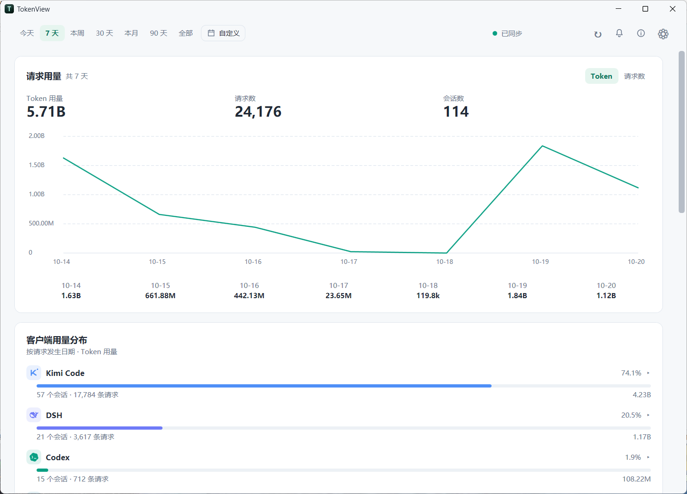

# TokenView

**English** | [简体中文](README.zh-CN.md)

TokenView is a local-first Windows desktop app for analyzing usage metadata from AI coding clients.
It stores data in a local SQLite database, reads client data without modifying it, and never uploads
usage data or includes telemetry. The only outbound requests are the fixed update check and the
public announcement/About mirrors described below. The assembly, data directory, database, and
settings file all use the TokenView name.



The current implementation is C# / .NET 10 / WPF.

## Minimal by design

TokenView is built around a deliberately minimal interface: a single window, one accent color, and
flat cards where numbers and charts do the talking. There is no account, no feature sidebar, and no
ads or upsell — open the app and usage is immediately on screen. The same sparse layout holds in
light and dark themes and down to an 800×600 window. That restrained footprint matches the app
itself: everything stays local, with no telemetry and no uploads.

## Features

- Overview, trends, model rankings, session metadata, and data-source status.
- Read-only collectors for Codex, Claude Code, OpenCode, DSH, Kimi Code, MiMoCode, Pi Desktop,
  Pi Agent, WorkBuddy, GitHub Copilot, Gemini CLI, Grok CLI, MCode, Devin, Command Code, Cline,
  Qoder, and CodeArts.
- Explicit separation of measured, derived, estimated, unknown, and partial data.
- Local data clearing, configurable source collection, and statistics/settings storage relocation.
- Dark and light themes, tray integration, autostart, and configurable sync schedules.
- Update checks against the fixed GitHub Releases `latest.json` endpoint, with optional daily
  automatic download and SHA-256-verified restart installation.
- GitHub Actions release workflow: pushing a `v*` tag tests, publishes, packages, and uploads the
  Windows zip plus `latest.json`.
- Remote announcement (startup + every 20 minutes) and About-page dynamic info, fetched as Markdown
  from a fixed list of public mirrors, cached in memory only, with persistent unread state.

Model and client icons are bundled locally; unknown models keep their original names and use a
neutral fallback icon.

Change the storage directory in Settings → 数据与隐私. Existing statistics and preferences move
together; resetting preferences keeps the selected directory. A small location file remains in the
system application directory. Window state stays managed by the desktop app.

## Requirements

- Windows 10 or 11 (x64)
- .NET SDK 10

## Development

```bash
dotnet build wpf/TokenView.Wpf/TokenView.Wpf.csproj -c Release
dotnet run --project wpf/TokenView.Wpf
```

A running TokenView instance can lock `bin/Debug`; use `-c Release` or close the app before
rebuilding Debug.

## Verification

```bash
dotnet test wpf/TokenView.Tests/TokenView.Tests.csproj -c Release
```

`wpf/TokenView.Probe` is a headless tool for syncing a database copy and checking totals:

```bash
P=wpf/TokenView.Probe/bin/Release/net10.0-windows/TokenView.Probe.dll
dotnet $P copy "$APPDATA/com.tokenview.app/tokenview-usage.sqlite3" /tmp/db.sqlite3
dotnet $P sync /tmp/db.sqlite3 --force
dotnet $P totals /tmp/db.sqlite3
dotnet $P announcement
dotnet $P about-info
```

## Repository layout

```text
wpf/TokenView.Wpf/        WPF desktop app
  Data/                 SQLite storage, queries, collectors, token semantics
  Services/             sync, tray, autostart, theme, window state, updates
  Controls/             custom charts and date range picker
  Settings/             settings.json model and store
  Assets/               app icon and icon source
wpf/TokenView.Probe/      headless sync/query/content verification tool
wpf/TokenView.Tests/      xUnit tests for mirror fetching, config merge and read state
docs/                   specifications, data-source research, and README images
scripts/                read-only database reconciliation helper
```

## Privacy

- Collectors only read client metadata; session text is never persisted.
- Measured, derived, and estimated values are kept visually distinct.
- No telemetry and no uploads. The only outbound requests are the fixed update check (never downloads
  or installs automatically) and the announcement/About Markdown fetch from a fixed public mirror list
  (startup + every 20 minutes; no local data is uploaded, images and HTML are not loaded).
  Announcement bodies stay in memory; only the read hash is persisted.

See `AGENTS.md` and `docs/` for the full rules.
